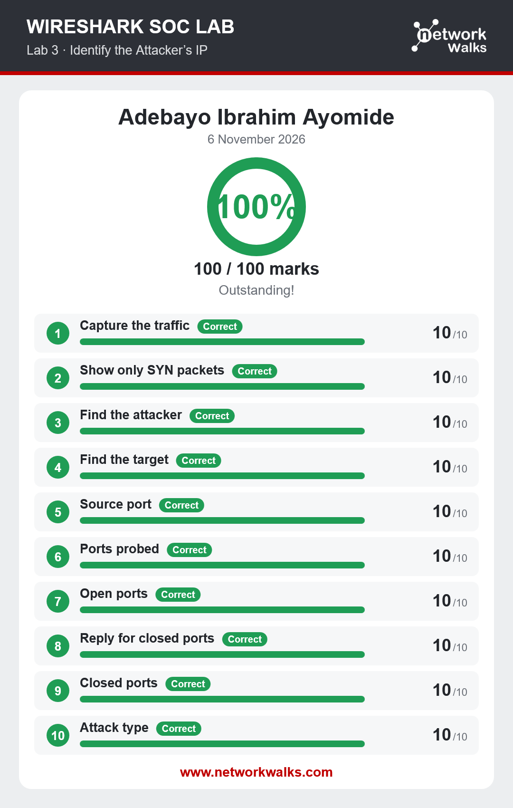
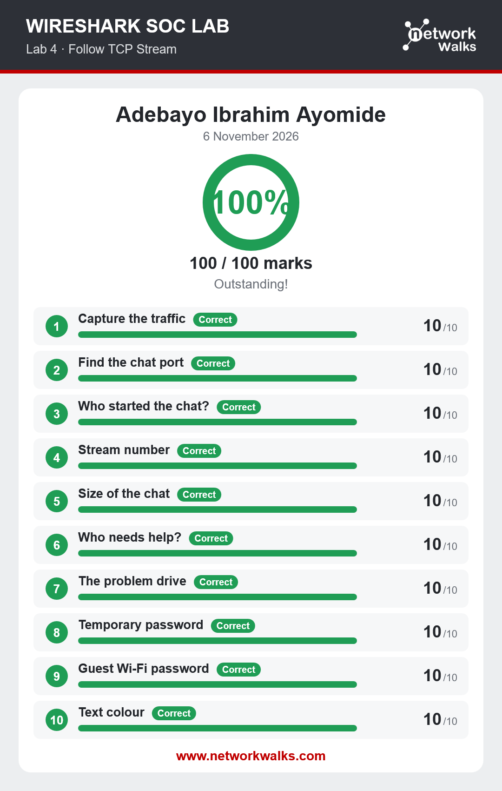
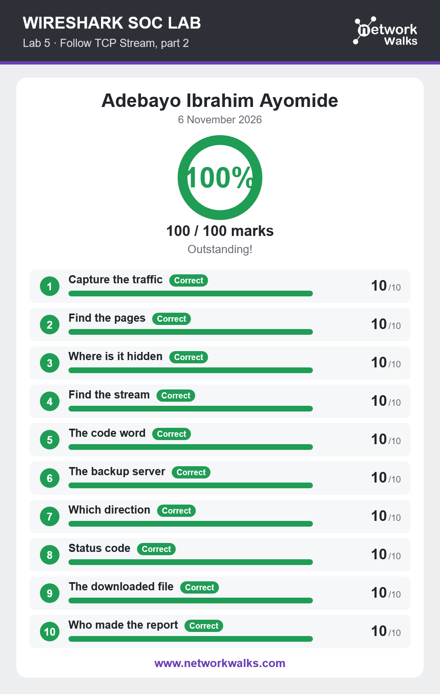
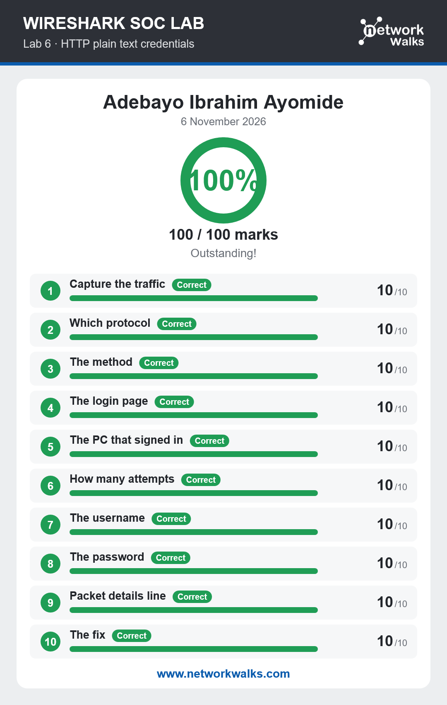
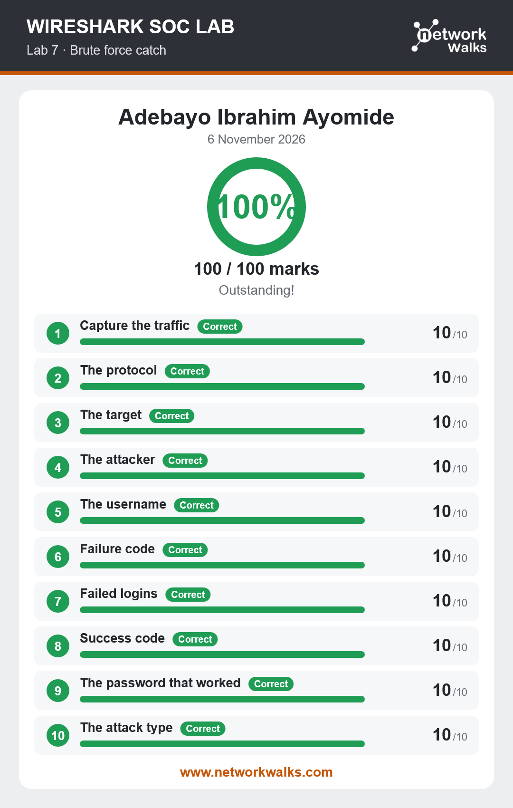

# Wireshark lab

## 📌 Project Overview
This project focuses on capturing and analyzing packets, following tcp stream, finding hidden data sent in plain text over http, analyzing repeated login attemps and analyzing calls over SIP and RTP.

## 🛡️ Purpose of the Lab
The lab aims to give student real-life practical experience on the use of wireshark and experiencing how SOC works.

## Lab 3
In this lab, I identified an attacker ip-address: 192.168.10.66 and the target ip: 192.168.10.20 .

## Lab 4
In this lab, I followed a tcp stream to read what was sent through a chat box.

## Lab 5
In this lab, I followed a tcp stream again, but this time to find hidden data like password, secret keys and other hidden data.

## Lab 6
In this lab, I found usernames and passwords sent in plain text over http. Hence, we should always ensure to send our data over the secure http-https it pass our data through a safe encrypted channel.

## Lab 7
In this lab, I analyzed repeated login attemots and found who was guessin passwords or bruteforcing.

## Lab 8
In this lab, I analyzed, played a call and identified the scammer. 

# 🔐 Security & Ethical Use

This laboratory is intended strictly for education purposes only.

---

# 🔗 Tool

- **Wireshark:** [https://wireshark.org/](https://wireshark.org/)

---

# 👤 Author

**ADEBAYO IBRAHIM**\
Cybersecurity Professional B084

LinkedIn: [www.linkedin.com/in/ibrahim-adebayo-118613449](www.linkedin.com/in/ibrahim-adebayo-techie/)

---

## 📌 Project Information

**Program Name:** Cybersecurity at Networkwalks | **Week:** 01 | **Project:** Wireshark Lab | **Repository:** GitHub
